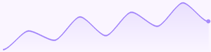

# sparklinekit

[](https://github.com/nao1215/sparklinekit/actions/workflows/ci.yml)
[](https://github.com/nao1215/sparklinekit/actions/workflows/gitleaks.yml)
[](https://github.com/nao1215/sparklinekit/actions/workflows/trivy.yml)
[](https://github.com/nao1215/sparklinekit/actions/workflows/osv-scan.yml)
[](https://hex.pm/packages/sparklinekit)
[](https://hexdocs.pm/sparklinekit/)
[](https://hex.pm/packages/sparklinekit)
[](./LICENSE)
[](https://scorecard.dev/viewer/?uri=github.com/nao1215/sparklinekit)

Sparklines for Gleam: Unicode blocks for a terminal, and line or bar charts as SVG text or PNG bytes. It depends only on `gleam_stdlib`, runs on Erlang and JavaScript, and writes PNG files without an image library.


```sh
gleam add sparklinekit@0
```

```gleam
import gleam/io
import sparklinekit

pub fn main() {
  let latency = [12.0, 14.0, 13.0, 40.0, 85.0, 33.0, 15.0, 12.0, 11.0, 13.0]
  io.println("latency  " <> sparklinekit.blocks(latency))
  // latency  ▁▁▁▄█▃▁▁▁▁
}
```

## Line and bar charts

`line_svg` and `bar_svg` return a standalone `<svg>` element, and `line_png` and `bar_png` return the same chart as PNG bytes. Both take a record of options; start from the defaults and change the fields you need.

```gleam
import sparklinekit.{LineOptions}

pub fn revenue_chart() -> String {
  sparklinekit.line_svg(
    [1.0, 5.0, 3.0, 8.0, 4.0, 9.0, 6.0],
    LineOptions(
      ..sparklinekit.default_line_options,
      theme: sparklinekit.ocean,
      smoothing: 0.25,
      area: sparklinekit.GradientArea,
      spot_radius: 3.0,
    ),
  )
}
```

Bars grow from zero, so negative values hang below it in the theme's `negative` colour:

```gleam
import sparklinekit.{BarOptions, Theme}

pub fn win_loss_chart() -> String {
  sparklinekit.bar_svg(
    [3.0, -2.0, 5.0, -4.0, 6.0, -1.0],
    BarOptions(
      ..sparklinekit.default_bar_options,
      theme: Theme(
        ..sparklinekit.default_theme,
        foreground: "#22A06B",
        negative: "#E5484D",
      ),
      gap: 3.0,
    ),
  )
}
```


PNG output can be written to a file with simplifile:

```gleam
import simplifile
import sparklinekit

pub fn save_chart() {
  sparklinekit.line_png([1.0, 5.0, 3.0, 8.0, 4.0], sparklinekit.default_line_options)
  |> simplifile.write_bits(to: "chart.png", bits: _)
}
```

## Themes

A `Theme` holds the foreground, background, area and negative colours. The default theme draws in `currentColor`, so an SVG chart takes the colour of the text around it. The package also has ten fixed themes:

| Theme | Foreground | Background | Negative | Preview |
|---|---|---|---|---|
| `ocean` | `#2563EB` | `#FFFFFF` | `#94A3B8` |  |
| `forest` | `#10B981` | `#FFFFFF` | `#EF4444` |  |
| `sunset` | `#F97316` | `#FFFFFF` | `#7C3AED` |  |
| `mono` | `#0F172A` | `#FFFFFF` | `#94A3B8` |  |
| `neon` | `#22D3EE` | `#020617` | `#F472B6` |  |
| `pastel` | `#A78BFA` | `#FAF5FF` | `#FB7185` |  |
| `crimson` | `#DC2626` | `#FFFFFF` | `#94A3B8` |  |
| `slate` | `#475569` | `#FFFFFF` | `#F59E0B` |  |
| `amber` | `#F59E0B` | `#FFFFFF` | `#DC2626` |  |
| `midnight` | `#F8FAFC` | `#020617` | `#FB7185` |  |

## Notes

- An empty series gives an empty string, or an `<svg>` and a PNG with nothing drawn. A single value, or a series where every value is the same, is drawn as the middle block, a flat line at half height, or half-height bars.
- SVG output escapes `&`, `"`, `<` and `>` in colours, but it is not sanitised for embedding in arbitrary HTML. PNG output reads only hex colours (`#rgb`, `#rgba`, `#rrggbb`, `#rrggbbaa`).
- PNG output is not compressed, so an image is about `width * height * 4` bytes. Use SVG when size matters.
- How the package is tested is described in [doc/testing.md](doc/testing.md).

## Verifying releases

Each GitHub Release attaches the Hex package tarball (`sparklinekit-<version>.tar`), `checksums.txt`, a cosign signature bundle (`checksums.txt.sigstore.json`) and build provenance (`sparklinekit-<version>.intoto.jsonl`). Download the assets, then:

```sh
gh attestation verify sparklinekit-<version>.tar --repo nao1215/sparklinekit

cosign verify-blob \
  --bundle checksums.txt.sigstore.json \
  --certificate-identity-regexp '^https://github\.com/nao1215/sparklinekit/\.github/workflows/release\.yml@refs/tags/v' \
  --certificate-oidc-issuer https://token.actions.githubusercontent.com \
  checksums.txt
sha256sum --check checksums.txt
```

## License

[MIT](LICENSE)
