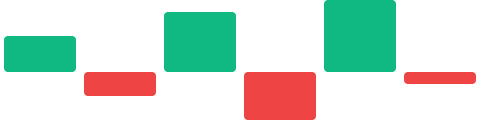
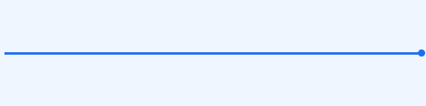
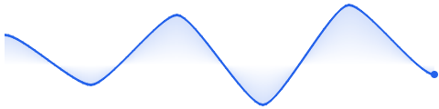

# sparklinekit

[](https://github.com/nao1215/sparklinekit/actions/workflows/ci.yml)
[](https://github.com/nao1215/sparklinekit/actions/workflows/gitleaks.yml)
[](https://github.com/nao1215/sparklinekit/actions/workflows/trivy.yml)
[](https://github.com/nao1215/sparklinekit/actions/workflows/osv-scan.yml)
[](https://hex.pm/packages/sparklinekit)
[](https://hexdocs.pm/sparklinekit/)
[](https://hex.pm/packages/sparklinekit)
[](./LICENSE)
[](https://scorecard.dev/viewer/?uri=github.com/nao1215/sparklinekit)

Sparklines for Gleam: Unicode blocks for the terminal, SVG strings for
the browser, and PNG bytes for everything else. Pure Gleam with no
runtime dependencies; CI runs it on Erlang and JavaScript. The full API
is on [HexDocs](https://hexdocs.pm/sparklinekit/).




## Install

```sh
gleam add sparklinekit
```

## Unicode block sparkline

```gleam
import sparklinekit/unicode

pub fn shape() -> String {
  unicode.render([1.0, 5.0, 22.0, 13.0, 5.0, 2.0, 7.0])
  // -> "▁▂█▅▂▁▃"
}
```

```gleam
import sparklinekit/unicode

pub fn shape_from_ints() -> String {
  unicode.render_ints([1, 5, 22, 13, 5, 2, 7])
  // -> "▁▂█▅▂▁▃"
}
```

```gleam
import gleam/io
import sparklinekit/unicode

pub fn print_latency(samples: List(Float)) -> Nil {
  io.println("latency  " <> unicode.render(samples))
}
```

`print_latency([12.0, 14.0, 13.0, 40.0, 85.0, 33.0, 15.0, 12.0, 11.0, 13.0])`
prints:

```text
latency  ▁▁▁▄█▃▁▁▁▁
```

## SVG line

```gleam
import sparklinekit/line

pub fn minimal_line() -> String {
  line.new([1.0, 5.0, 3.0, 8.0, 4.0])
  |> line.to_svg
}
```

returns:

```text
<svg xmlns="http://www.w3.org/2000/svg" width="240" height="60" viewBox="0 0 240 60" preserveAspectRatio="none"><path fill="none" stroke="currentColor" stroke-width="2.0" stroke-linecap="round" stroke-linejoin="round" d="M 1.0 59.0 L 60.5 25.86 L 120.0 42.43 L 179.5 1.0 L 239.0 34.14"/></svg>
```

Options chain onto the builder. The images at the top are drawn with
similar options by [`test/gen/sample.gleam`](test/gen/sample.gleam):

```gleam
import sparklinekit/line
import sparklinekit/theme

pub fn area_line() -> String {
  line.new([1.0, 5.0, 3.0, 8.0, 4.0, 9.0, 6.0])
  |> line.with_theme(theme.ocean())
  |> line.with_smoothing(0.25)
  |> line.with_area_fill(True)
  |> line.with_spot(3.0)
  |> line.to_svg
}
```

Instead of a theme you can set `with_color("#378ADD")`,
`with_size(240, 60)` and `with_stroke_width(2.0)` directly, and
`line.new_ints` takes a `List(Int)`.

## SVG bar

```gleam
import sparklinekit/bar
import sparklinekit/theme

pub fn rounded_bar() -> String {
  bar.new([3.0, 7.0, 2.0, 9.0, 5.0, 11.0, 6.0])
  |> bar.with_theme(theme.sunset())
  |> bar.with_corner_radius(3.0)
  |> bar.with_bar_gap(4.0)
  |> bar.to_svg
}
```

Negative values get their own colour:

```gleam
import sparklinekit/bar

pub fn win_loss() -> String {
  bar.new([3.0, -2.0, 5.0, -4.0, 6.0, -1.0])
  |> bar.with_color("#22A06B")
  |> bar.with_negative_color("#E5484D")
  |> bar.with_bar_gap(3.0)
  |> bar.to_svg
}
```

## PNG output

`to_png/1` on the same builders returns 8-bit RGBA PNG bytes, which
you can pass to `simplifile.write_bits` or `bit_array.base64_encode`.

```gleam
import sparklinekit/line

pub fn line_png() -> BitArray {
  line.new([1.0, 5.0, 3.0, 8.0, 4.0])
  |> line.with_color("#378ADD")
  |> line.with_size(240, 60)
  |> line.with_smoothing(0.25)
  |> line.with_area_fill(True)
  |> line.to_png
}
```

```gleam
import simplifile
import sparklinekit/line

pub fn save_to_disk() {
  line.new([1.0, 5.0, 3.0, 8.0, 4.0])
  |> line.to_png
  |> simplifile.write_bits(to: "chart.png", bits: _)
}
```

## Themes

A theme sets four CSS colours at once (`foreground` / `background` /
`area` / `negative`) through `line.with_theme` or `bar.with_theme`.
Call `with_color` / `with_background_color` / `with_area_color` /
`with_negative_color` afterwards to override one of them.

| Theme | When to use | Foreground | Background | Negative | Preview |
|---|---|---|---|---|---|
| `theme.ocean()` | Default-ish blue, neutral dashboards | `#2563EB` | `#FFFFFF` | `#94A3B8` |  |
| `theme.forest()` | "Up" / growth, finance-style green | `#10B981` | `#FFFFFF` | `#EF4444` |  |
| `theme.sunset()` | Attention, trending, warm accents | `#F97316` | `#FFFFFF` | `#7C3AED` |  |
| `theme.mono()` | Print, monochrome dashboards | `#0F172A` | `#FFFFFF` | `#94A3B8` |  |
| `theme.neon()` | Dark-mode UIs, high contrast | `#22D3EE` | `#020617` | `#F472B6` |  |
| `theme.pastel()` | Low-saturation, soft palettes | `#A78BFA` | `#FAF5FF` | `#FB7185` |  |
| `theme.crimson()` | Losses, alerts, "attention required" | `#DC2626` | `#FFFFFF` | `#94A3B8` |  |
| `theme.slate()` | Corporate neutral, brand-agnostic | `#475569` | `#FFFFFF` | `#F59E0B` |  |
| `theme.amber()` | Finance / warning, softer than red | `#F59E0B` | `#FFFFFF` | `#DC2626` |  |
| `theme.midnight()` | Dark-mode default, off-white on navy | `#F8FAFC` | `#020617` | `#FB7185` |  |

Without `with_theme` you get `theme.default()`: a `currentColor`
foreground that inherits the surrounding CSS colour, no background, an
area tint derived from the foreground, and `#EF4444` for negative bars.

## Edge cases

### Empty input

```gleam
import sparklinekit/bar
import sparklinekit/line
import sparklinekit/unicode

pub fn empty_unicode() -> String {
  unicode.render([])
  // -> ""
}

pub fn empty_line_svg() -> String {
  line.new([])
  |> line.to_svg
  // -> "<svg ...></svg>" with no <path>
}

pub fn empty_bar_svg() -> String {
  bar.new([])
  |> bar.to_svg
  // -> "<svg ...></svg>" with no <rect>
}
```

For empty input, `line.to_png` and `bar.to_png` return a blank canvas at
the configured size, which works as a placeholder while data loads.

### Single value / all-equal series

Each renderer draws a single value its own way, and an all-equal series
such as `[5.0, 5.0, 5.0]` is drawn the same way.

| Renderer | Shape | Output |
|---|---|---|
| Unicode | middle block `▄` repeated | `unicode.render([5.0])` → `"▄"` |
| Line (SVG/PNG) | flat horizontal segment at the midpoint |  |
| Bar (SVG/PNG) | half-height bars rising from the bottom |  |

Bars stop at half height so a constant series does not look like a full
scale reading.

### Negative values

Unicode and line output scale to the observed `[min, max]`. Bars share
a zero baseline, so negative bars hang below it (third image at the
top).



### Colour handling

`with_color` accepts any CSS colour string and escapes `&`, `"`, `<`
and `>` in SVG attributes. PNG output accepts `#rgb`, `#rgba`,
`#rrggbb` and `#rrggbbaa` and falls back to the theme default for
anything else. The SVG output is not sanitised for arbitrary HTML, so
run it through DOMPurify or similar before embedding it there.

## Testing

| Technique | Bug class caught here |
|---|---|
| Examples and unit tests | [Wrong output for a renderer or builder option](doc/testing.md#examples-and-unit-tests) |
| Boundary values | [Crashes and wrong scaling on empty, flat, signed or extreme series](doc/testing.md#boundary-values) |
| Generated properties | [Malformed SVG / PNG, blocks outside the alphabet](doc/testing.md#generated-properties) |
| Metamorphic relations | [Pictures that change when the series only changes scale, offset or order](doc/testing.md#metamorphic-relations) |
| Differential testing | [Unicode buckets that differ from an independent implementation](doc/testing.md#differential-testing) |
| Fuzzing and snapshots | [Colour strings that break out of SVG attributes; unreviewed changes to coordinates and pixels](doc/testing.md#fuzzing-and-snapshots) |
| Nightly runs | [Rare inputs the normal run count misses](doc/testing.md#nightly-runs) |
| Mutation testing | [Assertions that miss a changed operator or branch](doc/testing.md#mutation-testing) |

## Verifying releases

Each GitHub Release attaches the Hex package tarball (`sparklinekit-<version>.tar`),
`checksums.txt`, a cosign signature bundle (`checksums.txt.sigstore.json`) and
build provenance (`sparklinekit-<version>.intoto.jsonl`). Download the assets, then:

```sh
gh attestation verify sparklinekit-<version>.tar --repo nao1215/sparklinekit

cosign verify-blob \
  --bundle checksums.txt.sigstore.json \
  --certificate-identity-regexp '^https://github\.com/nao1215/sparklinekit/\.github/workflows/release\.yml@refs/tags/v' \
  --certificate-oidc-issuer https://token.actions.githubusercontent.com \
  checksums.txt
sha256sum --check checksums.txt
```

## License

[MIT](LICENSE)
